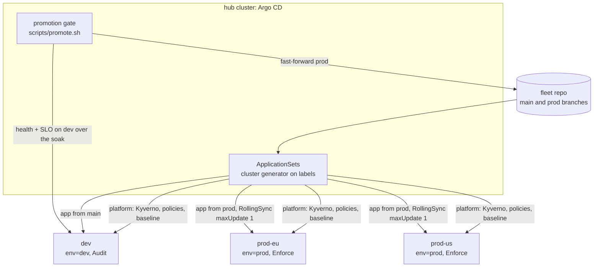

# k8s-fleet-gitops: architecture

The trade-offs, and why RollingSync alone couldn't order dev before prod, are in [`design.md`](design.md). This page is the system view.

## 1. Context

Running several Kubernetes clusters (environments, regions) creates three problems a single cluster doesn't have:
- every cluster must get the same platform and the same guardrails, including the cluster added next month;
- a release must reach production only after it has proven itself, and never all production clusters at once;
- nobody should be able to fix a cluster by hand and leave it different from the others.

The fleet solves all three with one Argo CD hub and labels instead of lists.

## 2. Layers and who owns them

| Layer | Contents | Applied to | Owner |
|---|---|---|---|
| Policy engine | Kyverno | every managed cluster | platform |
| Governance | no privileged pods, pinned tags, requests and memory limits, no hostPath; **Audit on dev, Enforce on prod** | every managed cluster | platform / security |
| Baseline | team namespaces with Pod Security labels, quotas, default-deny ingress, cluster identity | every managed cluster | platform |
| Apps | podinfo, the stand-in for a team service | dev from `main`, prod from `prod` | team, in a project that can't touch quotas or network policies |

**Onboarding** is registering a cluster with labels (`fleet/managed=true`, `env`, `region`). Nothing in Git names a cluster, so the fleet grows by labelling, and the live test measures how long a new cluster takes to become compliant.

## 3. The release path

1. **Merge to `main`:** dev clusters follow `main` and get the release.
2. **The gate:** `scripts/promote.sh` waits until every dev Application is Synced to exactly that commit and Healthy for the soak period, **and the release meets its SLO on dev during that soak.** It sends requests to the dev service through the dev API server's service proxy, and refuses if more than 5% fail or p99 latency exceeds the limit. Only then does it fast-forward `prod` to that commit.
   - "Healthy" only says the pods run and pass their probes. The SLO check catches the release that runs fine and serves errors.
   - Promotion only moves forward. A rollback is a new commit.
3. **Inside prod:** ApplicationSet progressive sync (RollingSync, `maxUpdate: 1`) updates one prod cluster at a time and waits for it to be Healthy before the next.
4. **Prod follows a branch only the gate moves,** so nothing merged to `main` during a prod rollout can slip into it.

## 4. Drift and break-glass

Platform Applications have `selfHeal: true`, so a manual change is reverted within seconds (measured live: a deleted default-deny NetworkPolicy). Break-glass is pausing auto-sync on one Application, which is visible in Argo CD and audited, not editing the cluster quietly.

## 5. Verification

| Check (`scripts/fleet-test.sh`, four kind clusters in CI) | Proves |
|---|---|
| 1. Bootstrap | Every managed cluster gets the platform and the app from Git; an unlabelled cluster gets nothing |
| 2. Governance | The same bad pod: rejected on prod (Enforce), admitted and reported on dev (Audit) |
| 3. Drift | A deleted NetworkPolicy is restored by Argo CD (timed) |
| 4. Onboarding | Labelling a registered cluster is all it takes to make it compliant (timed) |
| 5. Release | Dev only from `main`; the gate promotes; prod updates one cluster at a time (timestamps compared) |
| 6. Halt | A release that can't start on dev is refused at the gate and never reaches prod; a revert in Git recovers dev |
| **7. SLO** | A release that is Synced and Healthy but fails a third of its requests is refused by the gate's SLO check, and never reaches prod |

Offline: charts render for dev and prod with the right policy mode, and every manifest is schema-validated. Kyverno CLI unit tests: a good pod passes, each bad pod fails the right rule, and system namespaces are exempt.

## 6. Production differences

- An HA Argo CD with controller sharding, SSO with RBAC per project, and the hub itself managed by GitOps.
- Cluster registration written by provisioning (Terraform or Crossplane).
- Secrets from a vault per cluster.
- The gate as a pipeline job or Kargo, reading SLOs from Prometheus rather than probing through the API server.
- Sync windows for prod, and a fleet-wide compliance view (Policy Reporter, Kyverno metrics).
